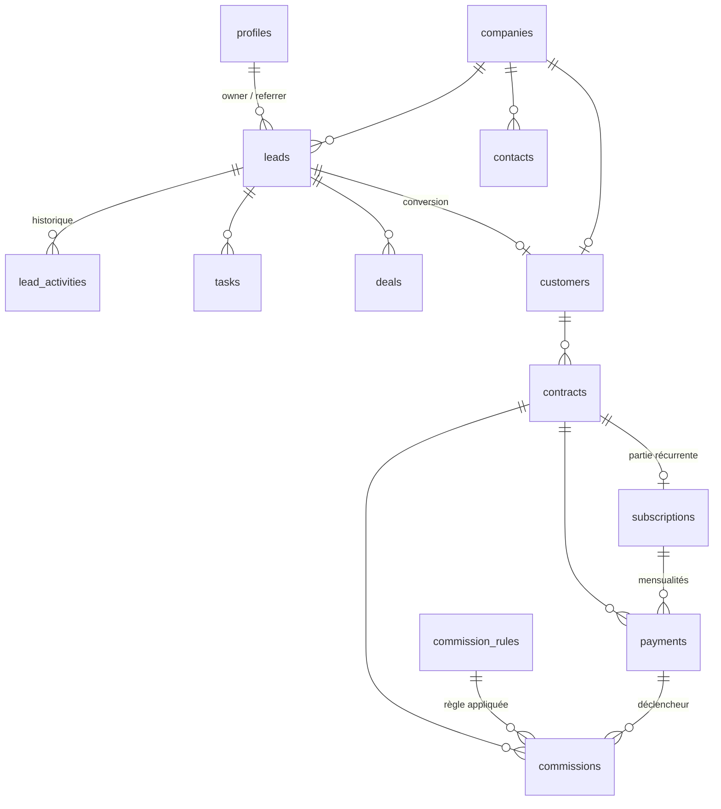

# Moka Studio Business Hub — Étape 1 : architecture

> Statut : V1 livrée (étapes 1 à 6). Voir le README pour l'installation, l'utilisation et les tests.

---

## 1. Principes directeurs

| Principe | Traduction concrète |
|---|---|
| La base est la source de vérité | Contraintes, ENUM, clés uniques, triggers et RLS dans PostgreSQL. L'interface ne fait que refléter ce que la base autorise. |
| Aucune logique sensible dans le navigateur | Calcul des commissions, conversion prospect → client, détection de doublons, KPI : fonctions SQL (`security definer`) ou Edge Functions. |
| Argent = entiers | Tous les montants en centimes `bigint`. Pourcentages en points de base (`2500` = 25 %). Arrondi unique : tranche 1 = `floor`, tranche 2 = reste. |
| Trois chiffres, trois sources | **CA encaissé** = `payments` encaissés · **CA contractuel** = `contracts` · **MRR** = `subscriptions` actives. Jamais additionnés entre eux. |
| Rien n'est réécrit | Prix figés dans le contrat, règles de commission versionnées, historique prospect append-only, journal d'audit. |
| Réel ≠ prévision ≠ démo | Données réelles en base ; prévisionnel = hypothèses (`financial_scenarios`) ; mode démo = jeu fictif hors base, bandeau permanent. |

---

## 2. Architecture technique

```
 Navigateur (React SPA, Vercel)                    Supabase
┌───────────────────────────────┐        ┌─────────────────────────────────┐
│ React + TS + Vite + Tailwind  │  HTTPS │ Auth (email + lien magique/MDP) │
│ TanStack Query (cache, états) │◄──────►│ PostgREST  ── RLS par rôle ──┐  │
│ supabase-js (clé ANON seule)  │        │ RPC SQL (security definer)   │  │
│ zod + react-hook-form         │        │ Triggers : audit, historique,│  │
│ dnd-kit (Kanban) · Recharts   │        │   commissions, garde-fous    │  │
└───────────────────────────────┘        │ PostgreSQL ◄─────────────────┘  │
                                         │ Edge Functions (clé SERVICE)    │
                                         │  └ admin-users            │
                                         └─────────────────────────────────┘
```

**Choix complémentaires à la stack imposée**

| Besoin | Outil | Pourquoi |
|---|---|---|
| Routage | React Router 6 | Standard, compatible réécriture SPA Vercel |
| Données serveur | TanStack Query | États de chargement/erreur, cache, invalidation après mutation |
| Formulaires | react-hook-form + zod | Mêmes schémas zod pour validation et typage |
| Kanban | @dnd-kit | Accessible, tactile (commerciaux sur smartphone) |
| Dates | date-fns (locale fr) | Léger, fuseau Europe/Paris |
| Types DB | `supabase gen types` | Types TS générés depuis le schéma réel |
| Tests | Vitest (logique), pgTAP via `supabase test db` (RLS), Playwright (parcours clés) | |

**Secrets** : seule `VITE_SUPABASE_URL` et `VITE_SUPABASE_ANON_KEY` vont dans le front (publiques par conception, protégées par la RLS). La `SERVICE_ROLE_KEY` n'existe que dans les Edge Functions. Stripe : non branché en V1, prévu côté Edge Function uniquement.

**Comptes** : inscription publique **désactivée** dans Supabase. L'admin invite les utilisateurs via l'Edge Function `admin-users`, qui crée le compte et le profil avec son rôle. Un profil est `is_active = false` par défaut.

---

## 3. Schéma de données

19 tables. Toutes ont `created_at`, et `updated_at` maintenu par trigger (sauf tables append-only).



| Domaine | Table | Rôle | Garde-fous clés |
|---|---|---|---|
| Identité | `profiles` | Rôle, nom, activation | Rôle hors `user_metadata` ; inactif par défaut |
| Paramétrage | `app_settings` | Hypothèses de gestion (1 ligne) | 5 €, 100 €, 25 %, 0 € ; bornes CHECK |
| | `offers` | Catalogue actuel | Prix ≥ 0 |
| | `objectives` | Objectifs mensuels globaux/par commercial | 1 objectif par (personne, mois, indicateur) |
| CRM | `companies` | Entreprise prospectée | SIREN 9 chiffres **unique** ; domaine normalisé indexé |
| | `contacts` | Interlocuteurs | Email et tél. normalisés (colonnes générées) ; 1 contact principal |
| | `leads` | Prospect dans le pipeline | **1 seul prospect ouvert par entreprise** ; « perdu » ⇒ motif obligatoire |
| | `lead_activities` | Historique (statuts, responsables, appels, notes) | Append-only |
| | `tasks` | Appeler, email, SMS, relancer, RDV, proposition | « fait » ⇔ date de réalisation |
| Ventes | `deals` | Opportunité / proposition | Ouvert ⇔ pas de date de clôture |
| | `customers` | Client issu d'un prospect | Garde `lead_id` → historique conservé |
| | `contracts` | Contrat signé | **Prix figés** + `offer_snapshot` ; fin d'engagement calculée ; « en ligne » ⇒ URL |
| | `subscriptions` | Récurrent (abonnement + option) | Base du MRR |
| | `payments` | Encaissements | 1 mensualité par mois et abonnement ; réf. externe unique |
| Commissions | `commission_rules` | Grille **versionnée** | 1 règle courante par (bénéficiaire, offre) ; tranches = 100 % |
| | `commissions` | 1 ligne = 1 tranche due | **Unique par contrat × bénéficiaire × offre × tranche** ; « payée » ⇒ réf. virement |
| Finance | `expenses` | Frais réels | Montant > 0 |
| | `financial_scenarios` | Hypothèses prévisionnelles | Clés obligatoires vérifiées ; 1 référence par type |
| Traçabilité | `audit_logs` | Qui a changé quoi, avant/après | Écrit par trigger uniquement |

**Doublons** — quatre signaux, du plus fort au plus faible :
1. SIREN identique → bloquant (index unique).
2. Email normalisé identique → bloquant sauf forçage admin.
3. Téléphone normalisé identique (`06 12…`, `+33 6 12…`, `0033 6…` → `33612…`) → bloquant sauf forçage admin.
4. Domaine du site identique → avertissement.

Un apporteur apprend seulement « déjà connu », sans voir qui détient le prospect.

---

## 4. Règles d'accès (RLS, implémentées à l'étape 2)

État actuel : politiques posées par la migration 0009 et testées rôle par rôle (`scripts/test-rls.mjs`).

| Donnée | Admin | Commercial | Apporteur |
|---|---|---|---|
| Profils | Tout (lecture/écriture, rôles) | Le sien + annuaire noms seuls | Le sien |
| Entreprises / contacts | Tout | Ceux de ses prospects/clients | Aucun accès direct |
| Prospects | Tout, attribue/réattribue | Les siens ; ne peut pas changer `owner_id`/`referrer_id` | Crée via RPC ; lit **statut seul** de ceux qu'il a transmis (RPC `my_referred_leads`) |
| Historique prospect | Tout | Celui de ses prospects ; ajout seulement | — |
| Tâches | Tout | Assignées à lui ou sur ses prospects | — |
| Clients / contrats | Tout | Les siens ; modifie statut et URL du site, **jamais les prix** | — |
| Paiements | Tout | Lecture sur ses contrats | — |
| Commissions | Tout ; seul à faire acquise → facturée → payée | Les siennes, lecture | Les siennes, lecture |
| Offres, règles, hypothèses, objectifs, dépenses, scénarios | Écriture | Lecture des offres actives | — |
| Journal d'audit | Lecture | — | — |

Toute création de prospect passe par la RPC `submit_lead` (contrôle doublons + bon propriétaire), la conversion par `convert_lead_to_customer`, les paiements de commissions par `pay_commissions` (idempotent, refuse une ligne déjà payée).

---

## 5. Règles métier clés

**Commissions** (moteur à l'étape 4)
1. Contrat signé → création des tranches « prévisionnelles » pour le commercial et l'apporteur éventuel, montant copié depuis la règle courante. Une règle à 0 € ne crée pas de ligne.
2. Abonnement : tranche 1 (50 %) acquise au 1er encaissement ; tranche 2 (50 %) acquise à la 3e mensualité encaissée.
3. Vente directe : 100 % au 1er encaissement.
4. Contrat annulé → tranches prévisionnelles annulées automatiquement.
5. Statuts : prévisionnelle → acquise → facturée → payée ; « payée » et « annulée » sont définitifs. Montant non modifiable après acquisition.
6. Nouvelle grille = nouvelle version ; rien n'est recalculé.

**KPI du dashboard** (calculés en SQL, étape 5)

| KPI | Définition proposée |
|---|---|
| Prospects qualifiés | Prospects passés à « intéressé » ou au-delà sur la période (via historique) |
| RDV obtenus | Passages à « RDV programmé » sur la période |
| Taux de transformation | Gagnés ÷ (gagnés + perdus) clôturés sur la période |
| CA encaissé | Σ paiements encaissés (date d'encaissement) − remboursements |
| CA signé non encaissé | Valeur engagée des contrats signés (mise en service + mensualités × engagement, ou prix de vente) − déjà encaissé |
| MRR / ARR | Σ abonnements actifs à la fin de période ; ARR = MRR × 12 |
| Trésorerie estimée | CA encaissé − commissions payées − dépenses − coûts variables − provision cotisations. Libellée « estimation ». |

**Prévisionnel** : moteur TypeScript pur, testé unitairement, alimenté par un scénario. Les graphiques séparent visuellement réel (trait plein) et prévision (pointillé).

**Mode démonstration** : route `/demo` branchée sur un jeu de données fictif en mémoire, via la même interface d'accès aux données que la version réelle. Il ne se connecte jamais à Supabase et affiche un bandeau permanent « Démonstration — données fictives ».

---

## 6. Arborescence

```
moka-hub/
├── supabase/
│   ├── migrations/            0001 → 0008 livrées (types → données de référence)
│   │                          0009 RLS (livrée) · 0010 RPC CRM · 0011 moteur commissions · 0012 KPI
│   ├── functions/admin-users/
│   └── tests/                 tests RLS pgTAP, un fichier par rôle
├── src/
│   ├── app/                   router, providers, AppLayout (sidebar, header, recherche), RoleGuard
│   ├── components/ui/         Button, Card, StatCard, DataTable, Modal, ConfirmDialog, Badge, EmptyState…
│   ├── lib/                   supabase.ts, money.ts (centimes ↔ €), dates.ts, csv.ts (UTF-8 BOM, « ; »)
│   ├── data/                  interfaces d'accès + implémentation Supabase + implémentation démo
│   ├── features/
│   │   ├── auth/              connexion, mot de passe oublié, profil
│   │   ├── dashboard/         KPI, filtres de période, graphiques 12 mois
│   │   ├── leads/             Kanban, tableau, fiche, historique, contrôle doublons
│   │   ├── tasks/             mes relances du jour, retards, prospects inactifs
│   │   ├── customers/         clients, contrats, abonnements, paiements, statut du site
│   │   ├── commissions/       listes, filtres, validation, paiement par lot, export CSV
│   │   ├── finance/           dépenses, moteur prévisionnel, 3 scénarios
│   │   ├── referrer/          espace apporteur (dépôt, suivi, commissions)
│   │   └── settings/          utilisateurs, offres, grille, hypothèses, objectifs
│   ├── types/database.ts      généré par `supabase gen types`
│   └── styles/                tokens de la charte (terracotta, crème, beige, anthracite)
├── scripts/verify-schema.mjs  vérification du schéma sur PostgreSQL embarqué
├── .env.example · vercel.json · vite.config.ts · tailwind.config.ts · tsconfig.json
└── README.md
```

---

## 7. Points à valider avant l'étape 2

| # | Question | Proposition par défaut |
|---|---|---|
| 1 | Le « premier encaissement » d'un abonnement inclut-il les 39 € de mise en service ? | Oui, le premier paiement encaissé, quel qu'il soit |
| 2 | Vente directe : commission versée en une fois ? | Oui, 100 % au premier encaissement |
| 3 | Remboursement ou résiliation après commission acquise : reprise ? | Pas de reprise automatique ; l'admin peut annuler une commission non payée |
| 4 | Un commercial peut-il accorder une remise ? | Non ; seul l'admin modifie un prix signé |
| 5 | Prospect déposé par un apporteur : qui l'attribue ? | L'admin, depuis une file « à attribuer » |
| 6 | Taux de transformation | Gagnés ÷ (gagnés + perdus) |
| 7 | Scénarios prudent / ambitieux | Prudent : 3 abos, 0,5 vente/mois, renouvellement 80 % · Ambitieux : 8 abos, 2 ventes, 100 % |
| 8 | « Renouvellement 100 % » | Aucun départ pendant l'engagement ; X % des clients reconduisent à 12 mois |
| 9 | Option planning sur une vente directe | Autorisée (crée un abonnement de 20 €/mois) |
